# 🔊 TV to Yandex Station Audio Sync

[](LICENSE)
[](https://developer.android.com/tv)
[](https://golang.org)
[]()

### 💬 Зачем нужен этот проект?

Если у вас дома есть телевизор со Smart TV (Android TV) и умная колонка Яндекс Станция Mini 2 с рутом, наверняка вам хотелось использовать Станцию как дополнительную мощную колонку для телевизора, чтобы получить глубокий, объемный звук и четкие голоса. 

Однако стандартное подключение по Bluetooth разочаровывает: телевизор сразу же **выключает собственные динамики**, а звук в колонке начинает **отставать от видео** — губы актеров не попадают в речь, а при попытке включить звук одновременно на ТВ и колонке возникает невыносимое эхо. К тому же управлять громкостью с одного пульта становится невозможно.

**Этот проект полностью решает эту задачу:**
Он связывает телевизор и Яндекс Станцию напрямую по домашней сети Wi-Fi. Динамики телевизора продолжают работать вместе со Станцией как единая акустическая система, звук идет **идеально синхронно (миллисекунда в миллисекунду, без эха)**, громкость на колонке меняется прямо с пульта телевизора, а при включении ТВ всё начинает работать само собой без лишних нажатий и настроек.

---

## 💡 О проекте и сравнение с Bluetooth

Обычно при стандартном сопряжении Яндекс Станции со Smart TV по Bluetooth возникают три ключевые проблемы:
1. Телевизор полностью отключает встроенные динамики.
2. Bluetooth A2DP создаёт задержку (200–500 мс), из-за чего сбивается синхронизация губ (lip-sync).
3. Невозможно сбалансировать звук, чтобы ТВ и Станция играли вместе как саундбар или стереопара.

**Решение на системном уровне:**
- Встроенные динамики ТВ **продолжают работать**.
- Звук параллельно захватывается на Android TV через системный `AudioPlaybackCapture` и передается по локальной сети (UDP) на Яндекс Станцию.
- **Никакого эха**: система динамически подстраивает буферизацию под конкретное запущенное приложение (YouTube vs Twitch).
- **Синхронизация громкости**: пульт от ТВ регулирует громкость телевизора и Станции одновременно в пропорции 2:1.
- **Полная автономность**: служба на ТВ автоматически стартует при включении телевизора без всплывающих окон подтверждения, а колонка автоматически освобождает аудиокарту для Алисы во время паузы.
- **Root-права на ТВ не требуются!**

---

## 📐 Архитектура системы

```mermaid
flowchart LR
    subgraph TV["Android TV (Android 11)"]
        direction TB
        APP["Приложения (YouTube, Twitch, Плееры)"]
        HAL["Android AudioFlinger (48kHz 16-bit)"]
        SPK_TV["Динамики ТВ"]
        SERVICE["TvAudioSync Service"]
        UDP_SEND["UDP Streamer"]
        
        APP --> HAL
        HAL --> SPK_TV
        HAL -.->|AudioPlaybackCapture| SERVICE
        SERVICE --> UDP_SEND
    end

    subgraph NET["Локальная сеть (Wi-Fi 5GHz / LAN)"]
        UDP_PKT["UDP Датаграммы (порт 19890)\n[Header: Magic, Seq, Vol, Delay] + [PCM 10ms]"]
    end

    subgraph STATION["Яндекс Станция (Linux ARM64)"]
        direction TB
        DAEMON["station-rx (Go Daemon)"]
        QUEUE["Dynamic Delay Queue (20–210 ms)"]
        ALSA["ALSA aplay (-B 20000 -R 10000)"]
        SPK_ST["Динамик Станции"]
        ALICE["Алиса (Quasar)"]

        DAEMON --> QUEUE
        QUEUE --> ALSA
        ALSA --> SPK_ST
        DAEMON -.->|Освобождение ALSA при тишине| ALICE
    end

    UDP_SEND --> NET
    NET --> DAEMON
```



---

## ✨ Ключевые возможности

### 1. Идеальный синфазный звук без эха (Dynamic Delay)
В телевизорах с 4K и MEMC (уплавнение движений) видеопроцессор задерживает изображение на 150–210 мс. Плееры по-разному взаимодействуют со звуковым трактом:
- **YouTube TV** использует туннелированный режим (`AUDIO_OUTPUT_FLAG_HW_AV_SYNC`), задерживая звук в динамиках ТВ на **~210 мс**.
- **Twitch** использует низколатентный нативный поток `AAudio`, где задержка динамиков составляет всего **~80 мс**.

Служба на ТВ в реальном времени отслеживает активное приложение через `UsageEvents` и передает требуемую задержку в заголовке каждого UDP-пакета. Демон на Станции динамически перестраивает глубину очереди без щелчков и прерываний.

### 2. Умная синхронизация громкости
Громкость телевизора транслируется на колонку по формуле комфортного баланса:
$$V_{station} = \left\lfloor \frac{V_{tv} + 1}{2} \right\rfloor$$

| Громкость ТВ | 1 | 2 | 3 | 4 | 5 | 6 | 7 | 8 | 9 | 10 | ... |
|---|---|---|---|---|---|---|---|---|---|---|---|
| **Громкость Станции** | **1** | **1** | **2** | **2** | **3** | **3** | **4** | **4** | **5** | **5** | ... |

Регулировка выполняется асинхронно через нативный микшер ALSA (`amixer set Master`), не создавая задержек в аудиотракте.

### 3. Автозапуск при включении ТВ (Zero-Touch Boot)
- Реализован `BootReceiver`, слушающий события `BOOT_COMPLETED`, `LOCKED_BOOT_COMPLETED` и `QUICKBOOT_POWERON`.
- Однократная выдача разрешения через ADB:
  ```bash
  adb shell appops set dev.antigravity.audiosync PROJECT_MEDIA allow
  ```
  навсегда отключает диалоговое окно «Начать запись экрана/аудио?». Приложение стартует службу в фоне абсолютно незаметно для пользователя.

### 4. Сохранение работоспособности Алисы (Watchdog)
Демон Станции непрерывно отслеживает поток данных. Если воспроизведение на ТВ поставлено на паузу или телевизор выключен, через **1500 мс** демон полностью закрывает субпроцесс `aplay`. Аудиоустройство ALSA освобождается, и голосовой ассистент Алиса мгновенно реагирует на команды.

---

## 🛠️ Сборка и установка

### Требования
- Компьютер с macOS или Linux.
- Android SDK (build-tools, platforms 30+).
- Go 1.20+ (с поддержкой кросс-компиляции под Linux ARM64).
- Включенная отладка по ADB на ТВ и на Яндекс Станции.

---

### Шаг 1: Сборка и развертывание сервиса на Android TV

```bash
cd tv-app

# 1. Сборка APK
./build.sh

# 2. Установка на телевизор (укажите IP вашего ТВ)
./deploy.sh <IP_ТЕЛЕВИЗОРА>
```

Скрипт `deploy.sh` автоматически:
- Установит `TvAudioSync.apk`.
- Выдаст системные разрешения `PROJECT_MEDIA` и `PACKAGE_USAGE_STATS` через `appops`.
- Запустит фоновую службу синхронизации.

---

### Шаг 2: Сборка и развертывание демона на Яндекс Станции

```bash
cd station-daemon

# 1. Кросс-компиляция под Linux aarch64
./build.sh

# 2. Установка на Яндекс Станцию (укажите IP Станции)
./deploy.sh <IP_СТАНЦИИ>
```

Скрипт `deploy.sh` скопирует бинарник `/data/audiosync/station-rx` и запустит его в фоне через `start-stop-daemon`.

---

## ⚙️ Структура репозитория

```
├── README.md               # Документация проекта на русском языке
├── LICENSE                 # MIT License
├── tv-app/                 # Исходный код Android TV приложения
│   ├── AndroidManifest.xml
│   ├── build.sh            # Скрипт сборки без Gradle (aapt, javac, d8, apksigner)
│   ├── deploy.sh           # Скрипт развертывания и выдачи прав через ADB
│   ├── res/                # XML-ресурсы и манифест баннера Android TV
│   └── src/dev/antigravity/audiosync/
│       ├── AudioSyncService.java   # Сервис захвата аудио и UDP-стриминга
│       ├── BootReceiver.java       # Приемник включения ТВ
│       └── MainActivity.java       # Точка входа и запрос разрешений
├── station-daemon/         # Демон приемника для Яндекс Станции
│   ├── main.go             # UDP-сервер, динамическая очередь задержки, ALSA-пайплайн
│   ├── build.sh            # Кросс-компиляция Go под Linux ARM64
│   └── deploy.sh           # Загрузка и запуск демона на Станции
└── docs/                   # Подробные исследования и спецификации
    ├── ARCHITECTURE.md     # Описание архитектуры и бинарного UDP-протокола
    └── LATENCY_RESEARCH.md # Исследование задержек MEMC, ExoPlayer vs AAudio
```

---

## 📊 Протестированное оборудование

| Устройство | Платформа | Роль |
|---|---|---|
| **Android TV / Google TV** | Android 10+ (MediaTek / Amlogic / Realtek) | Источник звука (захват) |
| **Яндекс Станция Mini 2** | Allwinner H616 / Linux 5.4 aarch64 | Приемник и вывод звука |

---

## 📄 Лицензия

Проект распространяется под лицензией [MIT](LICENSE). Вы можете свободно использовать, модифицировать и распространять данный код.
