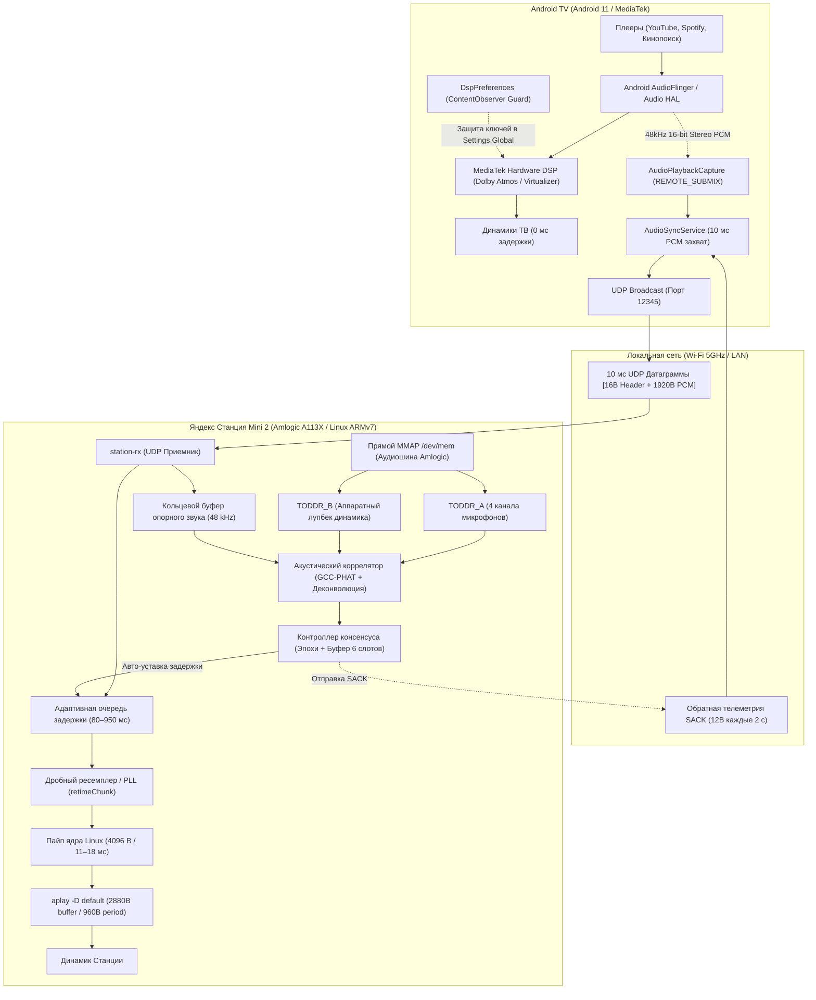

# 🔊 TV to Yandex Station Audio Sync

[](LICENSE)
[](https://developer.android.com/tv)
[](https://golang.org)
[]()

### 💬 Зачем нужен этот проект?

Если у вас дома есть телевизор со Smart TV (Android TV) и умная колонка Яндекс Станция Mini 2 с рутом, возможно вам хотелось использовать Станцию как дополнительную мощную колонку для телевизора, чтобы получить глубокий, объемный звук и четкие голоса. 

Однако стандартное подключение по Bluetooth разочаровывает: телевизор сразу же **выключает собственные динамики**, а звук в колонке начинает **отставать от видео** — губы актеров не попадают в речь, а при попытке включить звук одновременно на ТВ и колонке возникает невыносимое эхо. К тому же управлять громкостью с одного пульта становится невозможно.

**Этот проект полностью решает эту задачу:**
Он связывает телевизор и Яндекс Станцию напрямую по домашней сети Wi-Fi. Динамики телевизора продолжают работать вместе со Станцией как единая акустическая система, звук идет **идеально синхронно (миллисекунда в миллисекунду, без эха)**, громкость на колонке меняется прямо с пульта телевизора, а при включении ТВ всё начинает работать само собой без лишних нажатий и настроек.

---

## 🚀 Версия 2.0: Автономная акустическая автосинхронизация

В версии 2.0 проект полностью перешел от устаревших статических профилей и ручных кнопок к **автономной адаптивной акустической синхронизации в реальном времени**:

- **Zero Profiles (Ноль профилей приложений):** Система больше не пытается определять запущенное приложение через `UsageStats` и не передает никаких «подсказок» в пакетах. YouTube, Spotify, Кинопоиск, Twitch и системные плееры обрабатываются абсолютно одинаково.
- **Акустический контроль замкнутого цикла (Closed-Loop GCC-PHAT):** Микрофоны Яндекс Станции непрерывно измеряют фактическое время прихода звука от динамиков телевизора в комнату и подстраивают очередь воспроизведения с точностью до миллисекунды.
- **Частотная деконволюция ближнего поля:** Вместо нестабильных временных фильтров NLMS, прямое звучание динамика Станции рассчитывается и аккуратно вычитается из микрофонного спектра в частотной области ($\le 35\text{ мс}$). Звук телевизора остается нетронутым даже при громкой музыке.
- **Голосующий фильтр консенсуса (Voting Consensus):** Корректировка задержки применяется только тогда, когда **минимум 3 независимых акустических измерения подряд** согласуются с точностью до $\pm 9\text{ мс}$. Исключены любые автоколебания («пинг-понг») и реакции на случайные комнатные отражения.
- **Концепция эпох воспроизведения (`playbackEpoch`):** При паузах, смене треков или перемотке история измерений сбрасывается, выдерживается пауза успокоения акустики (900 мс).
- **Плавный ресемплинг (Retiming / PLL):** Дробный линейный пересчет сэмплов устраняет дрейф кварцевых генераторов без щелчков, треска и сброса буферов.
- **Сохранение микрофонов для Алисы и ChatGPT:** Сервис `station-rx` считывает микрофоны напрямую из физической памяти процессора Amlogic (`/dev/mem` mmap `TODDR_A`/`TODDR_B`) без блокировки аудиокарты ALSA. Устройство записи остается на 100% свободным для любых голосовых ассистентов.
- **Защита настроек звука ТВ (`DspPreferences`):** Встроенный ContentObserver предотвращает несанкционированный сброс Dolby Atmos и виртуализатора прошивкой телевизора.

> 📘 **Полная техническая спецификация:** подробный инженерный разбор математики GCC-PHAT, работы с DMA и сетевого протокола доступен в документе [docs/VERSION_2_ARCHITECTURE.md](docs/VERSION_2_ARCHITECTURE.md).

---

## 📐 Архитектура системы (Версия 2.0)



---

## ✨ Ключевые возможности

### 1. Автономное слияние звуковых волн (Haas Fusion Zone)
Система приводит разницу во времени прихода звука от динамиков ТВ и Станции к величине менее **6–8 мс** (физический порог слияния Хааса). Человеческий слух воспринимает оба излучателя как единую масштабную акустическую систему с четким виртуальным центром на экране телевизора без слышимого эха.

### 2. Защита и управление скрытыми модулями MediaTek DSP
Приложение предоставляет доступ к скрытым настройкам чипсета телевизора и предотвращает их конфликт:
- **Dolby Atmos (DAP)** — мастер-процессинг многоканального декодирования.
- **Dolby Surround Virtualizer** — расширение пространственной стереобазы.
- **MediaTek Bass Enhancement** — синтез субгармоник низких частот.
- **Dolby Dialogue Enhancer** — выделение формант человеческой речи и разборчивость голоса.
- **Dolby Volume Leveler** — выравнивание динамического диапазона (ночной режим).

Класс `DspPreferences` непрерывно защищает выбранные параметры от сброса прошивкой ТВ.

### 3. Синхронизация громкости с пульта ТВ
Громкость телевизора транслируется на колонку по формуле комфортного баланса:
$$V_{station} = \left\lfloor \frac{V_{tv} + 1}{2} \right\rfloor$$

| Громкость ТВ | 1 | 2 | 3 | 4 | 5 | 6 | 7 | 8 | 9 | 10 | ... |
|---|---|---|---|---|---|---|---|---|---|---|---|
| **Громкость Станции** | **1** | **1** | **2** | **2** | **3** | **3** | **4** | **4** | **5** | **5** | ... |

Регулировка выполняется асинхронно через ALSA softvol (`amixer set Master`), исключая любые задержки в аудиотракте. При отключении звука на ТВ (Mute) Станция также мгновенно глушит звук.

### 4. Автозапуск и нулевое обслуживание (Zero-Touch)
- Приложение на ТВ автоматически стартует при включении (`BOOT_COMPLETED`, `LOCKED_BOOT_COMPLETED`, `QUICKBOOT_POWERON`).
- Однократная выдача разрешений по ADB:
  ```bash
  adb shell appops set dev.antigravity.audiosync PROJECT_MEDIA allow
  adb shell appops set dev.antigravity.audiosync SYSTEM_ALERT_WINDOW allow
  adb shell pm grant dev.antigravity.audiosync android.permission.WRITE_SECURE_SETTINGS
  ```
  полностью устраняет диалоги подтверждения при каждом включении.
- При выключении ТВ демон Станции через 1500 мс тишины освобождает системный плеер `aplay`.

---

## 🛠️ Сборка и установка

### Требования
- Компьютер с macOS или Linux.
- Android SDK (build-tools, platforms 30+).
- Go 1.20+ (поддержка `GOOS=linux GOARCH=arm GOARM=7`).
- Включенная отладка по ADB на ТВ и на Яндекс Станции.

---

### Шаг 1: Сборка и развертывание приложения на Android TV

```bash
cd tv-app

# 1. Сборка APK (без Gradle, на чистых бинарниках SDK)
./build.sh

# 2. Установка на ТВ (укажите IP-адрес телевизора)
./deploy.sh <IP_ТЕЛЕВИЗОРА>
```

---

### Шаг 2: Сборка и развертывание демона на Яндекс Станции

```bash
cd station-daemon

# 1. Сборка бинарника под ARMv7 (Amlogic A113X)
./build.sh

# 2. Атомарное развертывание на Станцию
./deploy.sh <IP_СТАНЦИИ>
```

---

## ⚙️ Структура репозитория

```
tv-yandex-audio-sync/
├── README.md                      # Главное описание проекта (Версия 2.0)
├── LICENSE                        # MIT License
├── docs/
│   ├── VERSION_2_ARCHITECTURE.md  # Исчерпывающая архитектурная спецификация 2.0
│   ├── ARCHITECTURE.md            # Структура бинарного сетевого UDP-протокола
│   └── LATENCY_RESEARCH.md        # Исследования задержек AudioFlinger, HAL и MEMC
├── tv-app/                        # Исходный код приложения Android TV
│   ├── AndroidManifest.xml        # Манифест v1.3 (сборка 4)
│   ├── build.sh                   # Скрипт быстрой сборки APK (aapt, javac, d8, apksigner)
│   ├── deploy.sh                  # Автоматическая установка и выдача прав AppOps
│   ├── res/                       # Высококонтрастная разметка и Leanback-селекторы
│   └── src/dev/antigravity/audiosync/
│       ├── AudioSyncService.java  # Сервис непрерывного захвата 10 мс PCM и UDP-стриминга
│       ├── BootReceiver.java      # Автозапуск при включении телевизора
│       ├── DspPreferences.java    # Автоматическая защита настроек звука MediaTek DSP
│       └── MainActivity.java      # ТВ-интерфейс с живой телеметрией Станции
└── station-daemon/                # Демон автосинхронизации для Яндекс Станции
    ├── main.go                    # UDP-приемник, консенсусный контроллер, PLL-ресемплинг
    ├── acoustic_sync.go           # GCC-PHAT, частотная деконволюция, MMAP DMA-захват
    ├── build.sh                   # Кросс-компиляция Go под Linux ARMv7 (GOARM=7)
    └── deploy.sh                  # Атомарный деплой и безопасный перезапуск службы
```

---

## 📊 Протестированное оборудование

| Устройство | Платформа | Роль |
|---|---|---|
| **Vivax Smart TV / Android TV** | Android 11 (MediaTek MT9612 / MT9638) | Источник звука (захват) |
| **Яндекс Станция Mini 2** | Amlogic A113X / Linux ARMv7 (32-bit userland) | Акустический измеритель и приемник звука |

---

## 📄 Лицензия

Проект распространяется под лицензией [MIT](LICENSE).

