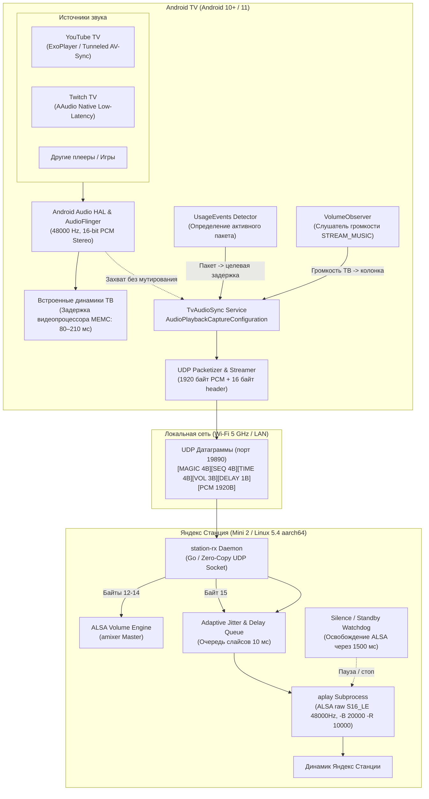

# Архитектура синхронизации звука (TV -> Yandex Station)

Система реализует распределенный аудио-мост реального времени между Android TV (Smart TV на платформе Android 10+) и Яндекс Станцией (Mini 2 / Linux ARM64).

---

## 1. Захват аудио на Android TV (`tv-app`)

- **API захвата**: `AudioPlaybackCaptureConfiguration` (доступен начиная с Android 10).
- **Спецификация аудио**: 48 000 Гц, 16-бит Stereo Linear PCM.
- **Размер кванта (chunk)**: 1920 байт (960 сэмплов = ровно 10 миллисекунд аудио).
- **Zero-touch Permissions**:
  - `PROJECT_MEDIA: allow` устанавливается один раз через `appops`. Android OS не показывает диалог подтверждения `MediaProjectionPermissionActivity`, служба стартует немедленно в фоне.
  - `PACKAGE_USAGE_STATS: allow` даёт доступ к `UsageStatsManager.queryEvents` для чтения событий фокуса окон без прав суперпользователя.

---

## 2. Протокол передачи (UDP Header)

Каждый пакет состоит из 1936 байт: 16 байт заголовок + 1920 байт PCM-данных.

| Смещение | Размер | Поле | Описание |
|---|---|---|---|
| `0..3` | 4 байта | `Magic` | `0x53594E43` (ASCII `"SYNC"`) |
| `4..7` | 4 байта | `Sequence` | 32-битный монотонно возрастающий номер пакета |
| `8..11` | 4 байта | `Timestamp` | Метка времени отправки (`SystemClock.elapsedRealtime() % 2^32`) |
| `12` | 1 байт | `TV Volume` | Текущий уровень громкости ТВ (`0..100`) |
| `13` | 1 байт | `Max TV Volume` | Максимальный уровень громкости ТВ |
| `14` | 1 байт | `Station Target Vol` | Вычисленный уровень для Станции по формуле: `(V_tv + 1) / 2` |
| `15` | 1 байт | `Target Delay / 10` | Требуемая акустическая задержка в единицах по 10 мс (например, `8` = 80 мс, `21` = 210 мс) |
| `16..1935` | 1920 байт | `Audio PCM` | 10 мс несжатого звука S16_LE 48000Hz stereo |

---

## 3. Приемник звука на Яндекс Станции (`station-daemon`)

Написан на Go и скомпилирован статически под Linux ARM64 (`aarch64`).
- **Слушает UDP-порт `19890`**.
- **Динамическая очередь задержки**:
  - Байт 15 парсится на лету. При переключении с YouTube (210 мс) на Twitch (80 мс) демон плавно перестраивает глубину очереди без щелчков.
  - Очередь буферизует ровно $N$ чанков по 10 мс:
    - Для YouTube: $\sim 12$ чанков (120 мс в очереди Go + 90 мс аппаратный путь ALSA = 210 мс).
    - Для Twitch: $\sim 2$ чанка (20 мс в очереди Go + 60 мс аппаратный путь ALSA = 80 мс).
- **ALSA Low-Latency параметры**:
  - Вызов `aplay -D default -B 20000 -R 10000 -t raw -f S16_LE -r 48000 -c 2 -q -`.
  - Уменьшение аппаратного буфера драйвера ALSA с 40 мс до 20 мс с порогом старта 10 мс исключает внутреннюю задержку ядра Linux.
- **Освобождение аудиоустройства (Standby Watchdog)**:
  - При отсутствии UDP-пакетов более 1500 мс демон закрывает stdin `aplay` и процесс завершается.
  - Это освобождает ALSA-устройство для штатного голосового ассистента Алиса и фоновых сервисов Яндекс Музыки (Quasar).
